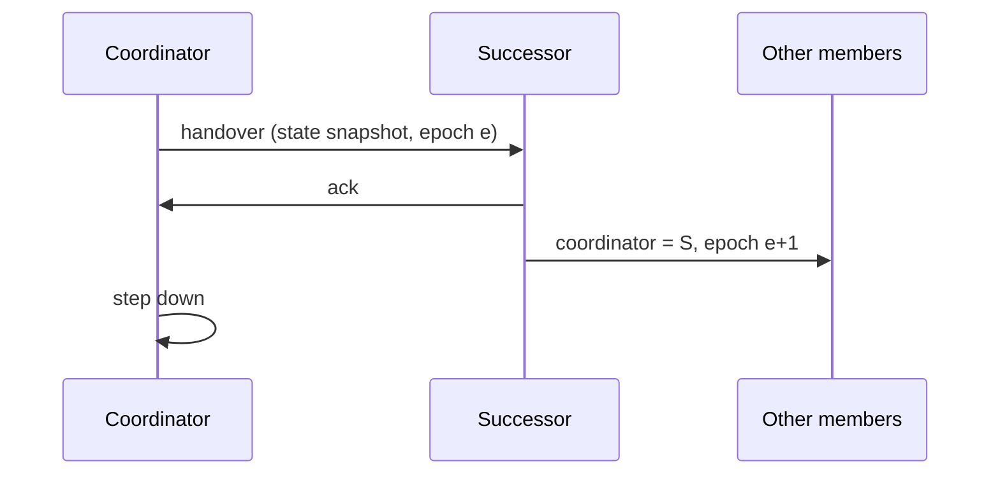
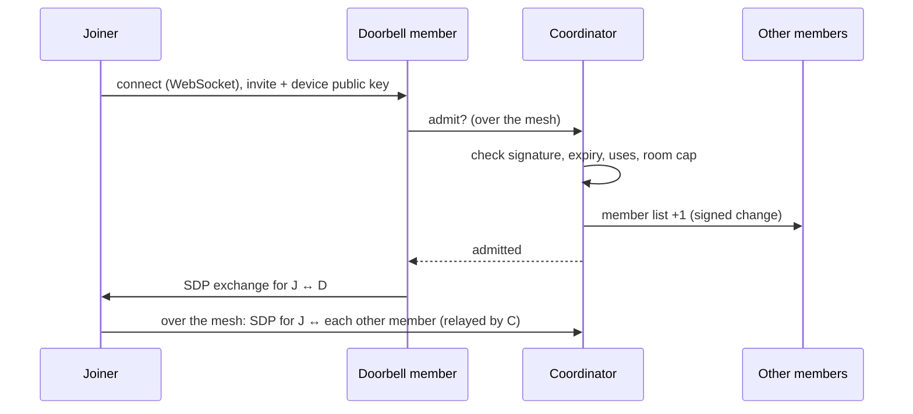

# Plan: no central service

**Status:** proposal. Nothing here is decided until it moves into the
decisions in [cast/AGENT_PROTOCOL.md](../cast/AGENT_PROTOCOL.md#decisions).
**Builds on:** [mesh.md](mesh.md) (one connection per pair of members),
[supernode-election.md](supernode-election.md) (trees, seeding, the check),
[multi-stream.md](multi-stream.md) (several streams per room).
**Follows:** [CONSTITUTION.md](../CONSTITUTION.md).

---

## Contents

- [Goal](#goal)
- [What a central server does today](#what-a-central-server-does-today)
- [Roles](#roles)
- [Reachability](#reachability)
- [Doorbell and STUN](#doorbell-and-stun)
- [Coordinator](#coordinator)
- [Heartbeat](#heartbeat)
- [Identity and membership](#identity-and-membership)
- [Creating, joining, rejoining](#creating-joining-rejoining)
- [LAN mode](#lan-mode)
- [Where keys and state live](#where-keys-and-state-live)
- [When things are checked](#when-things-are-checked)
- [Failure cases](#failure-cases)
- [What it costs](#what-it-costs)
- [Compute cost](#compute-cost)
- [Changes to the spec](#changes-to-the-spec)
- [Changes to the code](#changes-to-the-code)
- [Phases](#phases)
- [Open questions](#open-questions)

---

## Goal

`cast` is a voice and stream channel for a small group (up to 10), on one LAN
or across the world. It does **not** aim to be a full community platform.

**Every copy of `cast` is the same program, and the group needs no server.**
Any member can create a room, invite friends with a link, and the room keeps
working as members come and go. The jobs today's signaling server does are
spread across the members' copies.

**Done when:** a group of 10 can create a room, invite, join, stream, watch,
talk, survive the creator leaving, and come back the next day to the same
room, with no process running anywhere except on the members' machines.

---

## What a central server does today

| Job | Today | In this plan |
|---|---|---|
| First contact for a joiner | `cast signal` | **Doorbell**: every reachable member |
| Learning your public address | Google's public STUN server | **STUN**: every reachable member |
| Passing connection details (SDP) | `cast signal` relays them | Doorbell for the first connection; the mesh's data channels after that |
| Membership, room and stream caps | `cast signal` | **Coordinator**: one member |
| Supernode election, failure detection, failover, topology | `cast signal` | **Coordinator** |
| Upload speed test | `cast signal` (`/speedtest`) | Probes between members ([the check](supernode-election.md#the-check-what-to-measure-and-when)) |
| Relaying for a pair that can't connect directly | Nothing | A third member relays |
| TURN for "hide my IP" | Not deployed | A reachable member who opts in |

`cast signal` stays as a development and test tool. It's no longer needed to
use `cast`.

---

## Roles

| Role | How many | Who |
|---|---|---|
| **Member** | Everyone | — |
| **Doorbell + STUN** | Every reachable member, at the same time | Any member whose heartbeat says it's reachable |
| **Coordinator** | Exactly one | The most suitable member ([rules](#coordinator)) |
| **Pair relay** | As needed | Picked by the coordinator when two members can't connect directly |
| **TURN** for hidden members | 0 or 1 | A reachable member who opts in |
| Supernode, backup | Per stream | Elected by the coordinator ([supernode-election.md](supernode-election.md)) |

**Why the doorbell isn't a single role.** Every reachable member answers
joins and STUN requests at once. When one leaves, the others are already
serving, so there's nothing to hand over and no gap. Only the coordinator is
a single role, because it makes decisions.

---

## Reachability

A joiner can only start by reaching a member that accepts incoming
connections. A copy finds out whether it can, at startup and whenever its
network changes:

| Method | How | Fails when |
|---|---|---|
| Same LAN | mDNS ([LAN mode](#lan-mode)) | Not on the same network |
| UPnP IGD | Ask the router to forward a port (`huin/goupnp`, pure Go) | UPnP disabled on the router |
| NAT-PMP / PCP | Same, newer protocols (`jackpal/go-nat-pmp`; PCP also opens IPv6 pinholes) | Not supported by the router |
| Public IPv4 or IPv6 | Listen directly | Firewall blocks inbound |
| Manual port forward | User setting | — |
| Carrier-grade NAT | Nothing works | Common on mobile and some ISPs |

**Ports:** one configurable port number (default to be chosen), TCP for the
doorbell and UDP for STUN. The port mapping lease is renewed before it
expires.

**Confirming it.** A mapping that succeeded may still not be reachable (a
second router, an ISP filter). A copy reports `reachable: "probably"` after
mapping, and `"yes"` once another member has connected to it from outside.

**At least one reachable member is enough for everyone.** Unreachable members
dial out to it, learn their public address from its STUN, and connect to the
rest of the room through hole punching that it coordinates.

**Nobody reachable:** existing members carry on; new members can join only
on the same LAN, or by **reverse invite**: a reachable *joiner* sends their
own link and a member dials them. The app says so plainly.

---

## Doorbell and STUN

Every reachable copy runs two small listeners on its mapped port:

- **Doorbell (TCP, WebSocket):** speaks today's signaling JSON
  ([proto](../cast/internal/proto/proto.go)). A joiner connects, presents its
  invite or rejoin proof, and exchanges SDP for **one** connection: joiner ↔
  this member. Everything after that (the joiner's other 8 connections)
  goes over the mesh, with the coordinator relaying SDP on data channels.
  The WebSocket then closes.
- **STUN (UDP):** answers binding requests, so members learn their public
  address. `pion/turn` includes a STUN server; the same library provides
  TURN for the hidden-member role.

**Load:** joins are rare; one SDP exchange is a few KB, a STUN reply is about
100 bytes. Negligible on any member's machine.

**Code reuse:** today's [signaling server](../cast/internal/signaling/server.go)
splits in two: its WebSocket join handling becomes the doorbell; its room
state, election and monitor become the coordinator.

---

## Coordinator

**What it does:** admits members and writes the member list; enforces the
room cap (10) and stream cap (4); runs each stream's election and failure
detection; broadcasts the topology; relays SDP between members over data
channels.

**Who holds it:**

1. The first member, while alone.
2. Afterwards, the most suitable member: **not streaming, plugged in, wired,
   in the room longest** (ties by `clientId`). Streamers are never
   coordinator while anyone else is present (same spirit as D7).
3. Prefer a member that isn't also a relay, so one failure doesn't take out
   both.

It changes hands only for a reason: the coordinator leaves, starts streaming,
goes on battery, or stops being reachable on the mesh. A slightly better
member joining isn't a reason.

**Succession list:** every topology broadcast carries the room state, the
current epoch and an ordered **succession list**, so every copy always knows
who's next.

**Planned handover** (leaving, going live, battery):



**Crash or hang:** the coordinator sends a beacon with every topology update
and at least every 250 ms. If the successor hears none for **1 s**, it takes
over with `epoch + 1`. Everyone follows the highest epoch; a returning old
coordinator sees it and steps down.

**Split room** (network partition): each side may pick a coordinator. When
they reconnect, the side with more members wins; on a tie, the one earlier in
the succession list. Member-list changes made on both sides are merged
([member list](#identity-and-membership)).

**Load:** about 36 status messages per second from 9 members, an election
that takes microseconds, and small broadcasts. Any member's PC can do it.

---

## Heartbeat

All control traffic moves to **one data channel on each mesh connection**
(the [mesh](mesh.md) adds it; its cost is measured in Phase 0).

| Message | From → to | When | Carries |
|---|---|---|---|
| **Status** | Member → coordinator | Every 250 ms (as today) | Stream status (upstream, flowing/stalled); a `metrics` block when changed or every 5 s ([the check](supernode-election.md#the-check-what-to-measure-and-when)) |
| **Presence** | Member → coordinator | On change, and every 5 s | Reachable addresses and state (`no` / `probably` / `yes`), plugged in or battery, wired or Wi-Fi, time in room, **member list version and hash** |
| **Beacon / topology** | Coordinator → all | On change, and at least every 250 ms | Epoch, succession list, room state, streams and trees, **current doorbell and STUN addresses**, member list version |

**Doorbell and STUN availability follow the heartbeat:** the coordinator
collects every member's reachable addresses from presence messages and
broadcasts the current list. Copies use it for STUN in new connections and to
build invite links.

---

## Identity and membership

**Device key.** On first run, each copy generates an **ECDSA P-256** key
pair. `clientId` = SHA-256 of the device public key, encoded short. That is
the stable per-install identifier the spec already needs (change #4). The
device key is also the copy's **WebRTC certificate** (Pion accepts custom
certificates), so the fingerprint in its SDP identifies it.

P-256 because it's the one curve that TPM 2.0, Apple's Secure Enclave and
WebRTC certificates all support.

**Session certificate.** Hardware keys sign slowly, and a join opens 9
connections, each with a DTLS handshake that needs a signature. So the
hardware-held device key signs **once per app start**: it certifies a
short-lived software key, and that software key is the WebRTC certificate
for the session. Handshakes then cost about 14 µs each instead of a hardware
signature each. The member list records the device key; the session
certificate carries the device key's signature, which peers check.

**Room key.** The member who creates the room generates a room key pair
(P-256). **Room ID** = the first 128 bits of SHA-256 of the room public key,
base32-encoded. Every member's copy holds the room key (proposed; see
[open questions](#open-questions)), so any member can make invites and the
room doesn't depend on its creator.

**Invite.** Signed by the room key:

```jsonc
{
  "room": "<room ID>",
  "expires": "2026-11-21T20:00:00Z",   // default to be chosen, e.g. 24 h
  "maxUses": 5,                        // or 1 for single-use
  "nonce": "…",
  "by": "<clientId of the member who made it>"
}
```

**Join link:**

```
cast://join?room=<room ID>&at=<addr1>,<addr2>&invite=<invite + signature, base64url>
```

`at` lists the reachable members right now (empty for LAN-only rooms). Any
member can make a fresh link.

**Member list.** The room's list of admitted members. Each entry:

| Field | Meaning |
|---|---|
| `clientId` | Hash of the device public key |
| `publicKey` | Device public key (its certificate fingerprint) |
| `name` | Display name |
| `addedAt`, `addedBy` | When and by whom |
| `validUntil` | Optional expiry |

The list is a set of **signed changes** (add, remove), each signed by the
room key and numbered by the coordinator. Every copy saves it to disk. Copies
merge lists by union of changes: an entry is present if it was added and not
removed by a later change. The coordinator is the only writer while the room
is connected; merging only matters after a split.

**Invite use counting:** redemptions are recorded in the member list (one
add per use), so the coordinator can tell when an invite is used up.

---

## Creating, joining, rejoining

**Create:**

1. Generate the room key; room ID = hash of its public key.
2. Become coordinator; add self to the member list.
3. Try to become reachable (port mapping); start the doorbell and STUN if so.
4. Make an invite and show the link.

**First join (a friend with the link):**



The joiner saves the room ID, the room key it received, the member list and
everyone's last known addresses.

**Rejoin (any time later):**

1. Try every cached address of every member at once, plus mDNS on the LAN.
2. The first doorbell that answers sends a challenge; the copy signs it with
   its device key; the doorbell checks the key is on the member list.
3. Mesh connections follow as on first join. Each connection's handshake
   also checks the certificate fingerprint against the member list.

**Reliving an empty room:** if nobody is online, the first member back
restores the room from its saved state, becomes coordinator, and becomes the
doorbell if it's reachable. Others find it through cached addresses. If every
cached address has changed (home IPs change), someone needs a fresh link.

---

## LAN mode

Members on the same network find each other with **mDNS**: each copy
announces `_cast._tcp` with the room ID in a TXT record. A joiner on the LAN
needs only the room ID (or the link) and connects using local addresses: no
port mapping, no STUN. A room can mix LAN and internet members; LAN pairs
connect locally, remote pairs through the reachable members.

(The `cast` ICE setting that disables mDNS candidates stays; this mDNS is a
separate announcement for finding rooms.)

---

## Where keys and state live

| What | Secret? | Where |
|---|---|---|
| Device private key | Yes | **TPM 2.0 or Secure Enclave, non-exportable**; it only signs. Fallback: OS keychain or an OS-protected file |
| Room private key | Yes, but shared by members | On disk, **encrypted by a key held in the TPM / Secure Enclave** |
| Member list, room ID, cached addresses, invites made | No; integrity matters | On disk, signed |

| Platform | Device key store | Notes |
|---|---|---|
| Windows | TPM 2.0 via the Microsoft Platform Crypto Provider (NCrypt) | Callable from Go via system calls; no C code |
| Linux | TPM 2.0 via `go-tpm` (`/dev/tpmrm0`) | Pure Go |
| macOS | Secure Enclave via the Security framework | Needs C code (cgo), which the constitution keeps out of `cast`. The desktop app (or a small helper) holds the key and signs on the core's behalf through the agent API |
| No hardware | OS keychain / protected file | Same API, software key |

---

## When things are checked

| When | Check |
|---|---|
| App start, join, rejoin | Challenge signed with the device key; certificate fingerprint on every new connection |
| Reconnect or ICE restart | The new handshake checks the certificate again |
| **Every heartbeat** | **No credential check.** Heartbeats travel over connections already verified at their handshake; re-signing 4 times a second would add CPU and TPM wear without proving anything new |
| Member list changes | Connections to members no longer on the list close |
| An entry's `validUntil` passes | Checked against the clock about once a minute; no signing |
| Member list version in a heartbeat differs | Fetch the newer list and verify its signatures |

---

## Failure cases

| Situation | What happens |
|---|---|
| Coordinator leaves | Planned handover; nothing visible |
| Coordinator crashes | Successor takes over after 1 s; streams keep flowing meanwhile, failover waits for the new coordinator |
| Coordinator was also a relay and crashes | Takeover, then re-election: about 1–1.5 s for that stream's affected viewers |
| A doorbell member leaves | Other reachable members keep serving; their addresses are in the beacon |
| Every reachable member leaves | Existing members carry on; new internet joins wait for a reachable member, or use a reverse invite |
| A member's home IP changes | Its presence message updates the address; links with the old address stop working |
| All cached addresses stale when reliving | Someone sends a fresh link |
| Two members can't connect directly | The coordinator routes that pair's voice through a third member; the election avoids that edge for video |
| Room splits in two | Each side picks a coordinator; on rejoin the larger side wins and member lists merge |
| Port mapping lease expires | Renewed in advance; if renewal fails, the copy reports itself unreachable |

---

## What it costs

**To the project: nothing to run.** No doorbell, STUN or TURN servers. What
remains are distribution costs (Apple notarization, Windows code signing).

**To members:**

| Cost | Who | Amount |
|---|---|---|
| Doorbell and STUN | Reachable members | Negligible: a few KB per join |
| Coordinator | One member | Negligible CPU and bandwidth |
| Pair relay | A member relaying for a pair | That pair's voice: ≈ 23 MB per hour each way |
| TURN for a hidden streamer | The member who opts in | ≈ 4 GB per hour (one video copy plus voice) |
| Video relaying | Seeding members | ≈ 3.7 GB per copy-hour (already in the seeding design) |

---

## Compute cost

Measured with the mesh measurement program (10 members in one process,
loopback, Pion v4.2.27 with `cast`'s codecs, ICE settings and default
interceptors; 30 s per phase; dev Mac) plus Go benchmarks. Per member, idle
(no media):

| Step | Memory | CPU (one core) | Goroutines per connection |
|---|---|---|---|
| Today: voice mesh | 1.6 MB | 0.63% | 16 |
| + [mesh](mesh.md) (idle video and game audio) | 2.2 MB | 0.69% | 18 |
| + a data channel per connection | 3.05 MB | 0.68% | 23 |
| + control traffic (status and beacon, 4 per second) | **3.3 MB** | **0.88% average** | 23 |

With everyone's voice live on top: 3.4 MB and 3.56% per member (3.38%
without the data channels and control traffic).

**Where the control CPU lands.** Control traffic added 2.0% of one core
across the whole room. The coordinator takes part in half of all control
messages (9 statuses in, 9 beacons out every 250 ms), so by that split it
carries about **1% of a core**, and every other member about **0.1%**. The
split is derived, not measured separately. Members already send the same
status messages to `cast signal` today, over WebSocket, so the real increase
for them is smaller.

**Everything else (benchmarks):**

| Work | Cost | How often | Total |
|---|---|---|---|
| Election for one stream, 10 members (today's `ElectPair`) | ≈ 1 µs | On changes | Negligible; the exact tree search proposed in [supernode-election.md](supernode-election.md) would be hundreds of µs, still negligible |
| Decoding one status message (JSON) | ≈ 1.2 µs | 36 per second at the coordinator | ≈ 0.004% of a core |
| P-256 signature (software) | ≈ 14 µs | Rejoin challenge; DTLS handshakes (Pion already signs these today) | Negligible |
| P-256 verification (software) | ≈ 33 µs | Member list changes, invites, handshakes | 10 entries ≈ 0.3 ms at join |
| Doorbell and STUN listeners | Idle goroutines | A few packets per join | Negligible |
| Port-mapping lease renewal, mDNS answers | A few packets | Minutes apart | Negligible |

**Not measured yet:** TPM and Secure Enclave signing time (typically far
slower than software, and it varies by chip), port mapping on real routers,
and all of this on a Windows gaming PC.

**Summary:** about **+0.8 MB per member** for the data channels, about
**+0.1% of a core per member**, and about **+1% of a core on whichever member
is coordinator**. The project's server cost goes to zero.

---

## Changes to the spec

[cast/AGENT_PROTOCOL.md](../cast/AGENT_PROTOCOL.md):

- **Decisions to add:** no central service is required; the coordinator is a
  member; doorbell and STUN run on every reachable member; identity is a
  device key, membership a signed list.
- **Session:** `session.join({ server, room, … })` becomes:
  - `room.create({ name })` → `{ roomId, link }`
  - `session.join({ link, … })` for a first join
  - `session.rejoin({ roomId, … })` for a known room
- **New methods:** `room.createInvite({ expiresInMs, maxUses })` → `{ link }`;
  `room.members()`; `room.removeMember({ clientId })`; `room.forget({ roomId })`.
- **Snapshot and events:** our roles (`coordinator`, `doorbell`), our
  reachability (`no` / `probably` / `yes`, addresses), the coordinator's
  `clientId` and epoch, member list version; events `role.changed`,
  `coordinator.changed`, `members.changed`, `reachability.changed`.
- **Errors:** `invite_invalid`, `invite_expired`, `invite_used_up`,
  `not_a_member`, `room_unreachable` (no member answered), `room_full`.
- **`clientId`** becomes the hash of the device public key; the app no longer
  generates it.

---

## Changes to the code

| Change | Where |
|---|---|
| Data channel on every mesh connection; control messages over it | `peer` (mesh from [mesh.md](mesh.md)), `proto` |
| Coordinator: room state, election, monitor and topology moved out of the HTTP server so they run inside a member | `signaling` → embeddable package; `peer` |
| Handover, takeover, epoch, succession list | new `coord` package |
| Doorbell listener (WebSocket, today's signaling JSON) and STUN (`pion/turn`) | `signaling` handler reused; `peer` |
| Port mapping (UPnP, NAT-PMP, PCP), reachability state, lease renewal | new `reach` package |
| mDNS announce and browse | new `lan` package |
| Device key, `clientId`, WebRTC certificate from the device key | new `identity` package; `peer/media.go` |
| Room key, invites, member list (signed changes, merge), persistence | new `room` package |
| TPM (Windows, Linux) and keychain fallback; macOS through the app | `identity` |
| CLI: `cast create`, `cast invite`, `cast join <link>`, `cast rejoin <room>` | `cmd/cast` |

---

## Phases

| Phase | What | Measured / tested |
|---|---|---|
| 0 | **Measure:** data channel cost (done on the dev Mac: [compute cost](#compute-cost)); repeat on a Windows gaming PC; TPM and Secure Enclave signing time; port mapping on a few real routers | Numbers on real hardware; how often mapping works |
| 1 | **Identity:** device key (software first), `clientId` from it, WebRTC certificate from it | Fingerprint check on connect |
| 2 | **Control over the mesh:** data channels carry status, SDP relay and topology | Existing failover tests pass with control over the mesh |
| 3 | **Coordinator in a member:** embed today's server logic; handover and takeover | Coordinator crash → takeover ≤ 1 s; handover with no visible effect |
| 4 | **Doorbell, STUN, reachability, invites:** listener, port mapping, signed invites, admission, member list | Join through a doorbell member; invite expiry and use count; creator leaves and joins still work |
| 5 | **Rejoin and reliving:** persistence, cached addresses, challenge | Everyone leaves; next day the room comes back |
| 6 | **LAN mode** | Join with no internet access |
| 7 | **Hardware key storage:** TPM on Windows and Linux; macOS via the app | Keys non-exportable; fallback works without a TPM |

**Order with the other plans:** [multi-stream](multi-stream.md) first (its
election and stream logic live in the code that becomes the coordinator),
then the [mesh](mesh.md), then this plan. `cast signal` keeps working
throughout for tests.

**Constitution:** product rule 1 ("the signaling server never carries audio
or video") becomes "no central service is required". Changed in its own
commit when this plan is adopted.

---

## Open questions

1. **Who can admit members:** every member (shared room key, proposed), or
   a chain where each member signs the people they invite?
2. **Invite defaults:** expiry (24 h?) and uses (1, 5, unlimited?).
3. **Default port** for the doorbell and STUN, and what the app shows when
   port mapping fails.
4. **Merging after a split:** union of signed changes (proposed), or the
   larger side's list wins outright?
5. **Removing a member:** any member, or only the room creator?
6. **Forgetting a room:** when a member leaves for good, should the others
   keep its entry until someone removes it?
