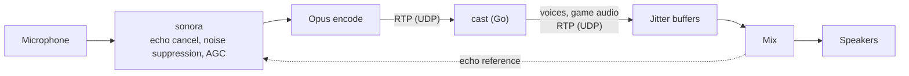

# voice

The voice chat audio engine for [cast](../cast/), run by `cast` as a sidecar
process. cast (Go) carries voice over WebRTC; this program does the audio:

- microphone → echo cancellation, noise suppression and gain control
  ([sonora](https://crates.io/crates/sonora), a pure-Rust port of WebRTC's audio
  processing) → Opus → RTP to cast
- RTP from cast (other people's voices, game audio) → jitter buffers → mix →
  speakers, with everything played used as the echo reference



```sh
cargo build --release            # needs libopus (brew install opus / apt install libopus-dev)
cargo build --release --features bundled   # or: build libopus from source, static (needs cmake)
cargo test
./target/release/voice --list-devices
```

Copy `target/release/voice` next to the `cast` binary and run cast with `-voice`.

Design, the process protocol, all flags, tests and troubleshooting are in the
[cast README](../cast/README.md#voice-chat).
